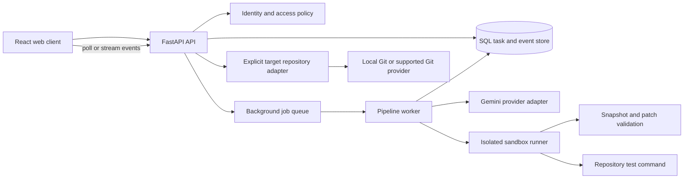

# RELAY AI Product and Engineering Blueprint

## Product outcome

RELAY AI accepts an engineering issue and a repository snapshot, produces a traceable proposed change, runs that change against the repository's tests in an isolated environment, presents evidence for a human decision, and performs only explicitly authorized repository operations.

## Product principles

1. Every task has a durable identity, status, timestamps, and append-only activity/evidence history.
2. AI output is untrusted input. Validate paths, patch scope, size, schema, and state transitions before acting on it.
3. A passing test run and reviewer recommendation are evidence, not automatic authorization.
4. Human approval is required before changing a target repository. Apply and commit must perform real Git operations and report their results.
5. Long-running work is asynchronous from the user's perspective: submit, receive task ID, watch progress, inspect result, decide.
6. Keep provider, persistence, sandbox, and API boundaries replaceable.

## Dashboard visual direction

The dashboard uses an Apple-inspired visual language while keeping RELAY AI's own identity: a bright neutral canvas, native system typography, translucent navigation surfaces, layered panels, soft depth, and blue primary actions. Follow the operating-system appearance by default, allow a persistent System/Light/Dark preference, and keep browser chrome aligned with the selected mode. Status and evidence colors remain semantic and readable; controls use clear focus rings and large touch targets. Use motion sparingly to explain state and hierarchy, honor `prefers-reduced-motion`, and avoid external font or image dependencies for core interface rendering. Keep the visual system responsive from narrow phones through wide desktop workspaces.

## Target architecture

### Component responsibilities

- **Web client:** report entry, ZIP upload, sample selection, task list/detail, stage timeline, diff and test/review evidence, and guarded approve/reject/apply/commit controls.
- **API:** validate requests, enforce authorization and state transitions, create/query tasks, accept actions, and expose health/readiness. It should not run model calls or tests in the request thread.
- **Task store:** durable task snapshots and append-only events, with transactional state changes and idempotency support.
- **Queue/worker:** execute triage, investigation, sandbox, and review; persist progress after each transition; support timeouts, cancellation, retries, and bounded concurrency.
- **Provider adapter:** Gemini structured-output calls, model/config selection, redacted errors, retry/rate-limit handling, token/cost telemetry, and a deterministic fake provider for local development.
- **Sandbox adapter:** validate a repository snapshot and patch, execute an allow-listed test command under resource/network limits, and capture bounded output and provenance. Production must not silently fall back to host subprocess execution.
- **Repository adapter:** bind a task to an explicit allow-listed local repository/worktree and base revision; re-check the base before apply; apply only the reviewed patch; create a real commit only after a separate explicit action. The optional GitHub REST adapter reads only configured repositories and opens a PR only after task approval and commit, after confirming the published head and base SHAs exactly match the task evidence. Branch publication is an explicit operator step. The adapter does not push, merge, or deploy.
- **Chat status adapter:** optionally post minimal progress and final review/test status to a configured Switch room through the documented outbound agent message API; inbound room event handling is not implemented.
- **Observability:** structured logs with task IDs, event history, health/readiness, metrics for queue latency, stage duration, failures, sandbox mode, and provider usage.

## Core task lifecycle

Current API state path: `QUEUED -> RUNNING -> TRIAGING -> TRIAGED -> INVESTIGATING -> PATCHED -> SANDBOX_RUNNING -> SANDBOX_TESTED -> REVIEWING -> AWAITING_HUMAN_APPROVAL -> APPROVED -> APPLIED -> COMMITTED`.

Terminal outcomes: `REJECTED`, `FAILED`, and `CANCELLED`. `RECEIVED`, `INVESTIGATED`, and `REVIEWED` remain declared compatibility states but are not emitted by the main pipeline path. Each active transition is centralized, validated, timestamped, and recorded as an event. Approval requires a patch, passing sandbox evidence, security `PASS`, and reviewer `APPROVE`. Apply requires human approval and a matching allow-listed repository/base revision; commit is a separate human action. The current local repository adapter supports task-owned copies and optional local Git targets. The optional GitHub adapter reads allow-listed repository metadata/files and opens a pull request from an already-published branch only after task approval and commit; it compares exact base/head SHA values with task provenance. Branch publication remains an operator step. No push, merge, or deployment endpoint is implemented. PR creation is recorded as an operator action without changing the pipeline lifecycle state.

The current pipeline has three model-backed calls: Stage A triage, Stage B investigation plus patch generation, and Stage C review. Sandbox tests run through a deterministic runner, and a human operator owns the approval decision. The orchestrator is workflow code, not a model specialist. An optional Switch room notifier posts outbound stage/status summaries; it does not consume inbound Switch events or start tasks from room messages.

## Implementation baseline

As of 2026-11-24, the local single-host MVP is implemented: the dashboard and versioned FastAPI API are connected; task, event, job, and action data persist in SQLite; the lease-based worker supports bounded retries and recovery; the Gemini provider is replaceable by a deterministic fake; patch validation and Docker sandbox execution fail closed; approval, apply, and commit are distinct audited operations; per-user token authorization is available; and the local repository and optional GitHub PR adapters are allow-listed. The UI includes task history, progress, evidence review, decision controls, responsive states, and the guarded PR flow. CI, host-free release checks, backup/restore tools, systemd/Nginx examples, a threat model, and runbooks are present.

This baseline is evidence of implemented local capabilities, not a production launch approval. As of the planning baseline, `main` and `origin/main` both point to `2449185` and the checkout had no source changes. No production host has been selected. Deployment-host sandbox isolation, proxy/auth/CORS, live backup/restore and alert delivery, owner reviews, Gemini data-use approval, accessibility sign-off, load evidence, and SLO acceptance remain release gates. The detailed execution order and evidence checklist are in [`PLAN.md`](./PLAN.md) and [`deploy/RELEASE_RUNBOOK.md`](./deploy/RELEASE_RUNBOOK.md).

## Main journeys

1. **Submit:** enter a report and upload/choose a repository snapshot; validate size/type/path limits; return task ID immediately.
2. **Follow progress:** task detail refreshes from persisted stage/event state; failures include safe diagnostics and a retry option where appropriate.
3. **Review result:** inspect triage, root cause, changed files, unified diff, patch validation, test command/output, reviewer verdict, and risks.
4. **Decide:** reject with notes or approve after reviewing evidence.
5. **Apply:** select/confirm an authorized target worktree; verify base revision and clean state; apply patch; record resulting revision.
6. **Commit:** separately confirm commit; create a real Git commit; persist actual hash and message.
7. **Operate:** list/search/filter tasks; retain and delete task data according to documented policy; inspect event/audit history.

## API contract direction

- `POST /api/v1/tasks` creates a task from JSON or multipart upload and returns `202` plus task ID.
- `GET /api/v1/tasks` lists authorized tasks with pagination and filters.
- `GET /api/v1/tasks/{id}` returns task state and result references.
- `GET /api/v1/tasks/{id}/events` streams or pages the persisted event timeline.
- `POST /api/v1/tasks/{id}/actions` accepts validated approve, reject, apply, commit, cancel, or retry commands with idempotency key.
- `GET /api/v1/scenarios` returns demo inputs; `GET /health` and `/ready` distinguish liveness from dependency readiness.

Keep current endpoints temporarily as compatibility aliases during migration.

## Data model direction

- **Task:** ID, owner, input metadata, status/current stage, model and policy version, timestamps, error summary, repository reference and base revision.
- **Task input:** report and bounded file/snapshot references; avoid duplicating large source payloads in event records.
- **Stage result:** triage, patch metadata/diff, sandbox execution evidence, reviewer assessment.
- **Task event:** immutable sequence number, timestamp, actor, stage, transition, safe details, correlation ID.
- **Action record:** actor, action, notes, idempotency key, outcome, timestamp.
- **Repository operation:** target reference, before/after revision, command/result, commit metadata.

Secrets, raw credentials, and unnecessary source contents must not be copied into logs or model error responses.

## Security and reliability requirements

- Configure explicit CORS origins; add authentication and per-task authorization before any shared deployment.
- Enforce request, archive, expanded archive, file-count, file-size, path-depth, and model-context limits.
- Canonicalize archive paths; reject absolute paths, traversal, symlinks, duplicate normalized paths, and unsafe file types.
- Treat prompt contents and generated diffs as untrusted. Verify every changed path belongs to the supplied snapshot and enforce changed-file limits.
- Execute code only in a hardened isolated runtime with no host secrets, no network by default, read-only inputs, resource limits, and bounded logs. Fail closed if required isolation is unavailable.
- Restrict test commands to configured argv profiles; never concatenate untrusted command strings into a shell.
- Use durable storage, task leases, bounded retries, timeouts, idempotency, and recovery of abandoned work.
- Apply/commit only against an authorized explicit target and expected base revision; audit all actions.
- Define retention/deletion, backup, and source-code handling policies before production use.

## Delivery roadmap and acceptance gates

The build phases below are complete; remaining work is an owner-led, single-host release process. Work must proceed in dependency order. A later phase cannot waive an earlier security, data, or operational gate. No public deployment, customer data, or untrusted repository execution is authorized by this blueprint. The plan is maintained in [`PLAN.md`](./PLAN.md); exact external asks and evidence fields remain in [`TRACKER.md`](./TRACKER.md), [`deploy/RELEASE_BLOCKERS.json`](./deploy/RELEASE_BLOCKERS.json), and [`deploy/RELEASE_SIGNOFF_TEMPLATE.json`](./deploy/RELEASE_SIGNOFF_TEMPLATE.json).

### Phase A — Freeze and identify the release baseline — READY

- Start from the reviewed `main` commit and confirm it matches the intended release revision.
- Run the documented host-free release suite and preserve the sanitized result and commit SHA.
- Review configuration examples, threat model, release blocker list, and sign-off template; keep secrets and repository contents out of evidence.
- **Gate:** source revision, CI result, host-free verification result, and package identity are recorded. This proves build readiness only.

### Phase B — Name the service and approve its operating boundary — BLOCKED

- Select the deployment host, public hostname, release/change window, and rollback owner.
- Assign primary and backup operators, security/escalation contact, and SLO owner.
- Obtain written approval for sending reports/repository source to the configured Gemini service, including the applicable data handling and retention terms.
- Accept or revise the provisional availability, pipeline completion, queue latency, recovery point, and recovery time objectives.
- Decide which optional integrations are enabled. Switch and GitHub live checks are required only if those integrations will be enabled in the release.
- **Gate:** named owners, target, data-approval reference, SLO thresholds, integration scope, and change window are recorded without credentials.

### Phase C — Prepare an isolated staging deployment — BLOCKED on Phase B

- Provision service identity, secret storage, persistent data and applied-workspace directories, encrypted backup destination, TLS certificates, and monitoring/alert receiver.
- Build the pinned sandbox image on the selected host; record its immutable image ID/digest. Never pull or build it implicitly during task execution.
- Configure production authentication, HTTPS CORS origins, Nginx limits/headers, local repository allow-lists, retention, backup schedule, and log/metrics collection.
- Use a staging hostname or network boundary; keep operator access restricted. Do not import customer or third-party source until data approval is effective.
- **Gate:** configuration validation and preflight pass; secrets are present only in the host secret manager; service starts with production settings and reports readiness correctly.

### Phase D — Run target-host and recovery verification — BLOCKED on Phase C

- Run `deploy/run_target_host_drills.sh` and record sanitized Nginx, auth, CORS, health/readiness, delivery-header, sandbox-isolation, image-digest, and resource-limit evidence.
- Run a controlled task using an approved test repository; verify source snapshot provenance, patch scope, sandbox evidence, reviewer gate, human approval, apply, and commit in the intended target copy.
- Run the approved load profile and inspect latency, errors, queue recovery, memory/CPU, and worker concurrency against accepted thresholds.
- Exercise a real backup freshness alert and restore a selected backup to a separate isolated location; verify database integrity, task/event history, source snapshot, and applied workspace.
- Complete keyboard-only and supported screen-reader review, plus responsive/error-state review, and retest every release-blocking defect.
- If enabled, verify Switch delivery to the provisioned room and GitHub read/PR behavior against a dedicated test repository and already-published matching SHAs. Keep these actions least-privileged and auditable.
- **Gate:** every applicable H6/H10 blocker has named-owner evidence, no unresolved severity-1 security/recovery/accessibility defect remains, and all accepted thresholds pass.

### Phase E — Controlled pilot and go/no-go — BLOCKED on Phase D

- Limit access to named pilot operators and allow-listed repositories. Start with low task volume and non-sensitive or explicitly approved source.
- Review every task outcome, audit record, notification, backup, alert, and support path during the agreed pilot period.
- Roll back on isolation/authentication failure, unapproved data flow, unrecoverable task loss, unexpected target mutation, or SLO breach.
- **Gate:** service owner, security owner, and operations owner sign the release record; unresolved blockers are explicitly accepted only if the release policy permits them. Otherwise keep the gate closed.

### Phase F — Post-pilot hardening and scale decision — DEFERRED

- Measure actual concurrency, queue delay, storage growth, token use/cost, failure rates, and operator effort before changing architecture.
- If a multi-host or higher-throughput requirement is demonstrated, design and test a server database, shared queue/leases, distributed rate limiting, durable metrics, migration/rollback, and backup consistency before implementing them.
- If identity requirements exceed controlled per-user bearer-token administration, select an identity provider and define account lifecycle, token rotation, revocation, and role governance before integration.
- **Gate:** architecture expansion has an owner-approved workload and threat model, migration/recovery plan, and acceptance targets. Do not treat speculative scale work as a launch prerequisite for the approved single-host pilot.

## Current scope and assumptions

- Build in small reviewable increments, preserving a working local demo.
- Python FastAPI remains the first backend; React/Vite remains the web client.
- Gemini remains the initial model provider behind an adapter boundary.
- SQLite is suitable for an initial durable local deployment; production database/queue choices should be made before multi-instance deployment.
- Applying changes to an external or arbitrary user repository is disabled unless a clean local Git target is explicitly allow-listed and bound to the task's expected base revision. GitHub PR access is separately allow-listed by repository ID and token; the adapter never publishes commits or merges/deploys them.
- The immediate plan is to close the single-host release gates, not to claim a general SaaS or multi-tenant launch. Host selection, data approval, named owners, and target evidence are external prerequisites.
- Dates for staging, pilot, or general availability are intentionally unset until the responsible owners select a host, change window, and acceptance thresholds.
